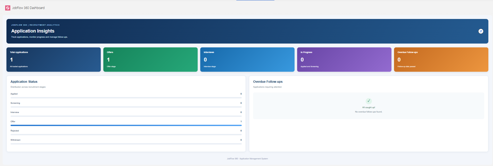

# JobFlow 360
### Salesforce Job Application Management System

JobFlow 360 is a Salesforce-based job application management system designed to help recruiters manage job postings, track candidate applications, monitor interviews, and automate follow-ups.

The project demonstrates Salesforce development skills using Apex, Lightning Web Components (LWC), SOQL, asynchronous Apex, and Salesforce automation.

## Dashboard Preview



## Key Features

- **Application Management:** Create, view, search, and manage job applications.
- **Job Posting Management:** Manage job postings and related information.
- **Interview Management:** Automatically create interview records when an application moves to the Interview stage.
- **Application Tracking:** Track application statuses, including Applied, Screening, Interview, Offer, Rejected, and Withdrawn.
- **Automated Follow-ups:** Scheduled Apex and Batch Apex for follow-up management.
- **Custom Dashboard:** Visual KPI cards, application status distribution, and overdue follow-up monitoring.
- **Reports & Analytics:** Reports for application statuses, offers, interviews, and overdue follow-ups.
- **Access Management:** Permission Sets, Organization-Wide Defaults (OWD), and Sharing Rules.

## Technologies Used

| Technology | Purpose |
|---|---|
| Salesforce Platform | CRM and application management |
| Apex | Backend business logic |
| SOQL | Salesforce data queries |
| Lightning Web Components | User interface |
| JavaScript | Component functionality |
| HTML & CSS | UI structure and styling |
| Salesforce CLI | Development and deployment |
| VS Code | Development environment |

## Salesforce Development Concepts

- Apex Classes and Triggers
- Trigger Handler Pattern
- Trigger Context Variables
- SOQL and DML
- Collections (List, Set, Map)
- Bulkification and Governor Limits
- Apex Test Classes and Test Data Factory
- Scheduled Apex
- Batch Apex
- Queueable Apex and Future Methods
- LWC Component Communication
- Wire Service and Imperative Apex
- Salesforce Security and Sharing

## Project Structure

```text
JobFlow360/
├── force-app/
│   └── main/
│       └── default/
│           ├── applications/
│           ├── classes/
│           ├── flexipages/
│           ├── lwc/
│           ├── objects/
│           ├── permissionsets/
│           ├── tabs/
│           └── triggers/
├── screenshots/
│   └── dashboard.png
├── config/
├── scripts/
├── sfdx-project.json
└── README.md
```

## Setup and Installation

### Prerequisites

- Salesforce Developer Edition or another suitable Salesforce org
- Salesforce CLI
- Visual Studio Code
- Salesforce Extension Pack

### Steps

1. Clone the repository:

```bash
git clone https://github.com/Omer-Farooq978/JobFlow-360.git
```

2. Open the project folder in VS Code.

3. Authorize your Salesforce org:

```bash
sf org login web
```

4. Set your default org if needed:

```bash
sf config set target-org YOUR_ORG_ALIAS
```

5. Deploy the project:

```bash
sf project deploy start
```

6. Run Apex tests:

```bash
sf apex run test --result-format human
```

## Testing

Apex test classes have been implemented for trigger handling, follow-up scheduling, and batch processing.

The project has previously passed its relevant Apex test executions. Final end-to-end project testing is planned before the portfolio release.

## Future Improvements

- Enhanced reporting and analytics.
- Additional dashboard visualizations.
- Further improvements to application management workflows.

## Author

**JobFlow 360 — Salesforce Development Portfolio Project**

Developed as a hands-on project to demonstrate Salesforce development, automation, and Lightning Web Component skills.
